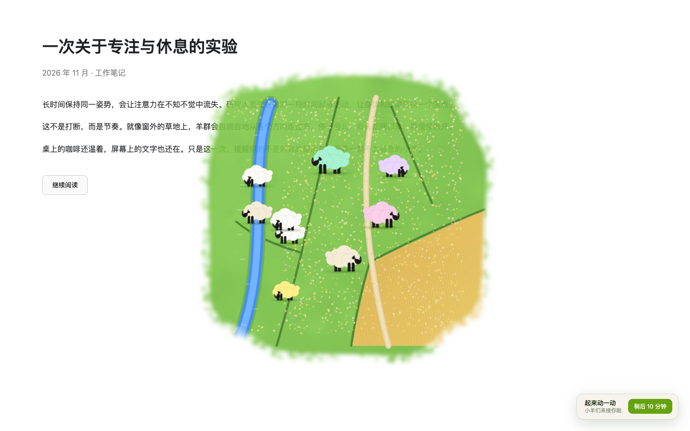

# 小羊起身提醒 · Sheep Break

一个 Chrome MV3 扩展：每隔一段时间，页面中心铺开一块草地，一群小羊从视口八方跑进来，在草地上漫步、吃草、张望，约 12 秒后自动散场。它只想轻轻提醒你起身活动，不抢焦点、不挡操作、不响一声。



## 特性

- **固定周期**：默认 30 分钟一次，`chrome.alarms` 唤醒，浏览器休眠/后台也不依赖页面定时器
- **中心草地**：`min(72vmin, 860px)` 的一块微缩地块，四周正常露出原网页，不透明度 0.9
- **八方来羊**：9 只大小错落的 SVG 云朵羊，从四边与四角错峰跑入，进场后切换 `walk / graze / idle` 状态
- **零打扰**：整层 `pointer-events: none` 点击穿透，只有右下角「稍后 10 分钟」按钮可点；无音效、不抢焦点
- **零外部素材**：草地用 Canvas 2D 运行时生成，羊是内联 SVG，扩展总体积 < 50KB（不含文档预览图）
- **样式隔离**：Shadow DOM，不会被宿主页面的全局 CSS 污染

草地纹理与羊群行为移植自 [aosgu/web · pastoral-meadow-diorama](https://github.com/aosgu/web/tree/main/pastoral-meadow-diorama)，将 Three.js 场景 2D 化后用于任意网页，详见 [架构文档](docs/architecture.md#素材来源与-2d-化)。

## 快速开始

1. 下载或 clone 本仓库
2. 打开 `chrome://extensions`，右上角开启**开发者模式**
3. 点「加载已解压的扩展程序」，选择仓库根目录（含 `manifest.json` 的那一层）
4. 点工具栏的小羊图标 → **「立即看一次」**，马上看到效果，不必等 30 分钟

> 安装时会提示「读取和更改所有网站上的数据」。这是定时自动注入必需的全站权限，原因见[权限说明](#权限说明)。

## 使用与配置

点工具栏图标打开面板：

| 控件 | 作用 |
|---|---|
| 启用提醒 | 总开关；关闭后清除主周期，开启后重新起算 |
| 提醒间隔 | 15 / 20 / 30 / 45 / 60 分钟，改动后立即重建周期并重新起算 |
| 状态 / 下次时间 | 显示当前状态与下一次预计触发时刻 |
| 暂停 1 小时 | 静默 60 分钟后自动恢复；暂停中按钮变为「恢复提醒」 |
| 立即看一次 | 强制触发一次预览，不受开关与暂停影响 |

草地右下角的卡片：

| 元素 | 行为 |
|---|---|
| 「起来动一动 / 小羊们来接你啦」 | 纯文案，随动画一起淡出 |
| 「稍后 10 分钟」 | 立即收场，并单独在 10 分钟后补一次提醒；**主 30 分钟节奏不变** |
| 不点任何东西 | 12 秒后自动淡出清理 DOM |

## 权限说明

| 权限 | 为什么需要 |
|---|---|
| `alarms` | 定时唤醒，替代会被页面/系统冻结的 `setInterval` |
| `storage` | 本地保存间隔、开关、暂停截止时间 |
| `scripting` | 到点向活跃标签注入动画脚本 |
| `<all_urls>` | 定时触发没有用户手势，`activeTab` 权限不生效；要在任意页面注入必须声明 host 权限 |

扩展**不采集、不上传任何数据**，不读取页面内容，只往页面插入一层动画 DOM。

以下页面无法注入，会静默跳过、不补播：`chrome://` 内部页、Chrome Web Store、浏览器内置 PDF 查看器，以及未开启「允许访问文件 URL」时的 `file://` 页面。

## 文档

| 文档 | 内容 |
|---|---|
| [产品方案](docs/product.md) | 需求边界、决策记录、交互时序、明确不做的范围 |
| [技术架构](docs/architecture.md) | 模块职责、alarm 调度、消息协议、动画层实现、性能与已知限制 |
| [开发与调试](docs/development.md) | 本地加载、改代码后何时刷新、可调参数、独立预览、发布清单 |

## 目录结构

```
sheep-break/
├── manifest.json          MV3 配置与权限
├── background.js          service worker：alarm 调度、标签查询、注入、消息处理
├── content/sheep.js       自包含动画层：草地生成 + SVG 羊群 + CSS 动画 + 卡片
├── popup/                 设置面板（HTML + JS）
├── icons/                 16 / 48 / 128 图标
└── docs/                  文档与效果预览图
```

`content/sheep.js` 不是常驻 content script，而是每次触发时由 `executeScript({ files })` 按需注入，因此**改它不需要刷新扩展**，下一次提醒自动生效；改 `manifest.json` / `background.js` / `popup/*` 才需要在 `chrome://extensions` 点刷新。

## 常见问题

**没有按时提醒？** 先确认总开关开启、未处于暂停；再看面板里的「下次」时间。浏览器完全休眠、活跃标签是不可注入页面时，该次会被跳过且不补播。

**羊群出现时能正常用页面吗？** 能。整层点击穿透，页面按钮照常可点，输入焦点不变。

**想改羊的数量、时长、配色？** 都在 `content/sheep.js` 顶部常量，见[可调参数表](docs/development.md#可调参数)。

**想让提醒更安静/更明显？** 草地透明度在 `content/sheep.js` 的 `.meadow { opacity }`，地块大小在 `FIELD`。

## 版本

`v1.0.0` · 中心草地版。变更记录见 [docs/development.md#版本记录](docs/development.md#版本记录)。
