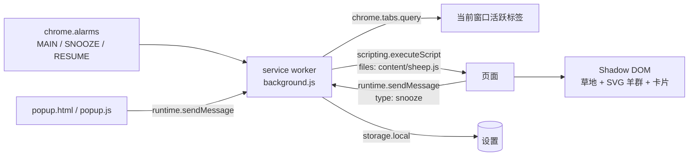

# 技术架构

## 总览

MV3，无构建步骤、无 npm 依赖、无外部资源。四个运行时部分：`background.js` 负责"什么时候提醒"，`content/sheep.js` 负责"提醒长什么样"，`popup/` 负责配置，manifest 声明权限。

关键：**`content/sheep.js` 不是常驻 content script**。它每次提醒才被注入，跑完 12 秒移除自身 DOM，不持有计时逻辑、不注册任何后台监听。

## 模块职责

| 文件 | 职责 |
|---|---|
| `manifest.json` | MV3 声明；`alarms` `storage` `scripting` + `<all_urls>`；service worker、action、图标 |
| `background.js` | 注册/重建 alarm；响应 alarm 与 popup 消息；查询活跃标签并注入；处理顺延与暂停 |
| `content/sheep.js` | 生成草地纹理、构建 Shadow DOM、绘制 9 只 SVG 羊、rAF 驱动动画、自动清理；点顺延按钮时回传消息 |
| `popup/popup.html` / `popup.js` | 268px 设置面板，读写状态、展示下次触发时间 |
| `icons/` | 16 / 48 / 128 PNG |

## 定时与调度

| alarm 名称 | 类型 | 行为 |
|---|---|---|
| `sheep-main` | 周期 | `delayInMinutes = periodInMinutes = intervalMin`，最小 0.5 分钟 |
| `sheep-snooze` | 一次性 | 10 分钟后单独补播一次，不动主周期 |
| `sheep-resume` | 一次性 | 60 分钟后清除 `pausedUntil` 并重建主周期 |

`isActive(settings) = enabled && pausedUntil <= Date.now()`。触发时若未激活直接返回；`preview` 消息用 `force = true` 绕过此检查。

`schedule()` 会先 `clear(MAIN)` 再 `create(MAIN)`，所以改间隔、开关、恢复暂停都会**重新起算一个完整周期**。

Chrome 的 alarm 在机器休眠后可能延迟触发；扩展不做追赶补偿，也不检测用户活动。

## 消息协议

`chrome.runtime.sendMessage`，payload 形如 `{ type, ... }`；`background.js` 用 `return true` 保持异步响应通道。

| type | 方向 | 参数 | 返回 / 副作用 |
|---|---|---|---|
| `getStatus` | popup → SW | — | `{ settings, nextAt }` |
| `setSettings` | popup → SW | `patch` | 写入 `storage.local` → `schedule()` → `{ ok: true }` |
| `snooze` | 页面 → SW | — | 创建 10 分钟一次性 alarm |
| `pause` | popup → SW | — | 写 `pausedUntil = now + 1h`、清 MAIN、建 RESUME |
| `resume` | popup → SW | — | 清 RESUME、清 `pausedUntil`、重建 MAIN |
| `preview` | popup → SW | — | `trigger(true)` 强制注入一次 |

## 存储结构

`chrome.storage.local`，默认值 `{ intervalMin: 30, enabled: true, pausedUntil: 0 }`。`pausedUntil` 是绝对时间戳（ms），暂停期用一次性 alarm 兜底恢复，避免 service worker 被回收后无人清理。

## 注入与动画层

### 为什么需要全站权限

`activeTab` 权限由用户手势（点扩展图标等）授予。alarm 自动触发时没有手势，因此 `executeScript` 要作用于任意站点，只能声明 `host_permissions: ["<all_urls>"]`。`chrome://`、Web Store、内置 PDF 查看器等仍受 Chrome 自身限制，`executeScript` 抛错时 `catch` 静默跳过。

### Shadow DOM 隔离

宿主页面常有 `* { ... }`、全局 `animation`、全局 `button { ... }` 之类的规则。所有样式关在 `attachShadow({ mode: 'open' })` 里，`:host` 用 `all: initial` + `position: fixed` + `z-index: 2147483647` + `pointer-events: none`；只有 `.card` 设 `pointer-events: auto`。因此页面按钮照常可点、输入焦点不变。

### 草地生成

`generateMeadowTexture(768)` 在页面里用 Canvas 2D 现画：

- 绿色渐变草底 → 麦田 → 树篱 → 沙土小路 → 蓝色蜿蜒河 → 野花
- `stippleDioramaBorder()` 用超椭圆轮廓 + 轮廓附近的点画 + 模糊，做 `destination-in` 遮罩，得到手绘羽化纸边
- 因羽化边需要 alpha，输出为 **WebP**（带透明通道）的 data URL，约 154KB；直接赋给 `element.style.backgroundImage`，不拼进 HTML 属性（超长 data URL 曾被引号截断）
- 生成失败时降级为纯 CSS 绿色渐变

地块 `FIELD = min(min(W,H) * 0.72, 860)`，`PAD = FIELD * 0.13` 是羊群活动范围的内缩量，用来避开羽化边并扣掉羊自身尺寸，保证羊只站在实心草地上。

### 羊群

9 只，出生点取 8 个方向（四边 + 四角，视口外 `OUT = 130px`），目标点由 `spotInField(scale)` 在草地实心区随机取；`delay = i * 110ms` 错峰。单帧 rAF 循环负责插值移动、按时间切换 `setAction()` 状态、10 秒触发淡出、12 秒 `host.remove()`。

动画全部是 CSS keyframes：`swing`（四腿交替 0.28s）、`bob`（身体颠簸）、`grazing`（低头 34°）、`look` / `breathe`（张望与呼吸）。SVG 由 `sheepSVG(wool)` 按羊毛颜色参数生成，配色沿用原项目 `WOOL_COLORS`。

`dismiss(snooze)` 统一负责取消 rAF、移除 host、可选回传 `snooze` 消息；重复触发时开头的 `document.getElementById(ROOT_ID)` 检查会直接 return，避免叠加多层。

## 素材来源与 2D 化

来源：[aosgu/web · pastoral-meadow-diorama](https://github.com/aosgu/web/tree/main/pastoral-meadow-diorama)（React + Three.js 微缩草地场景）。

| 原文件 | 处理方式 |
|---|---|
| `src/utils/textureGenerator.ts` → `generateMeadowTexture()` / `stippleDioramaBorder()` | 纯 Canvas 2D，**原样移植**，去掉 Three.js 贴图上下文；2048² → 768² 运行时生成 |
| `src/utils/meshBuilders.ts` → `createSheepMesh()` | 3D 几何体（羊毛球簇、脸腿、垂耳、软阴影）改为内联 SVG 云朵羊，沿用配色 |
| `src/components/ThreeCanvas.tsx` → 羊群状态机 | `walk / graze / idle` 切换、腿部摆动频率、身体颠簸参数改为 CSS keyframes |
| `src/scenes.ts` → `spawnSlots` / `bounds` | 出生点与边界收敛逻辑映射为视口坐标与 `PAD` 内缩 |

**没有搬 Three.js**：约 600KB 依赖，且每 30 分钟在任意页面起 WebGL 上下文与高分辨率贴图，会和宿主页面抢资源、增加兼容性风险。当前实现零依赖、零常驻渲染循环。

## 性能与实测

Playwright + 系统 Chrome，1440×900 模拟网页：

| 指标 | 结果 |
|---|---|
| 草地生成 + 注入 | 约 370ms |
| 草地 data URL | 约 154KB（WebP，内存驻留，不落盘） |
| 羊群落点 | 9/9 落在草地实心区 |
| 点击穿透 | 页面按钮可正常点击 |
| 自动收场 / 顺延 | 均正常移除 host |
| 页面 JS 报错 | 无 |

动画期间每帧只更新 9 个元素的 `transform` / `opacity`，不触发布局；`will-change: transform` 提示合成层。

## 已知限制

- 只在**当前窗口的活跃标签**播放；多窗口、后台标签不播放
- 不可注入页面静默跳过且不补播（见上）
- 播放过程中若页面跳转/SPA 重载，注入层随之消失，不会重播
- 高 DPI 下草地按 768² 拉伸到地块尺寸，属于有意的微缩手绘质感，非矢量清晰
- 极少数使用严格 CSP 的页面可能拦截 data URL 背景图；此时走降级渐变
- 全站权限会在安装时显示较重提示，这是定时注入的固有代价
